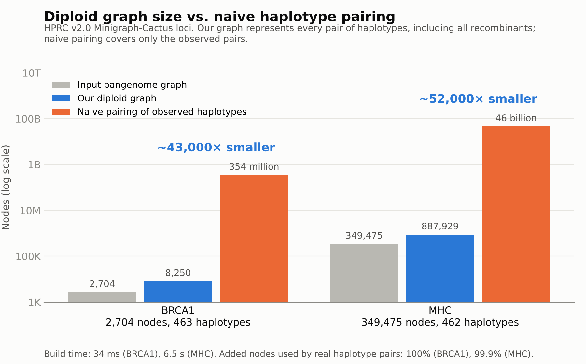

# diploidgraph

[](https://github.com/NafisehJ/diploidgraph/actions/workflows/tests.yml)

Compact **diploid sequence graphs** from two-terminal DAG sequence graphs.

A haploid sequence graph encodes haplotypes as source-to-sink paths. A diploid
sequence graph encodes **ordered pairs of haplotypes** as walks: every pair of
source-to-sink paths, including recombinant pairs that no sample carries.
`diploidgraph` keeps homozygous regions as a single copy of the input graph and
adds vertices only where two haplotypes can differ: one vertex per ordered pair
of branches at each parallel structure (P-node) of a series-parallel
decomposition, and, for graphs that are not series-parallel, pair states inside
the irreducible core that contains their W-motifs.

On two HPRC v2.0 pangenome loci (BRCA1 and MHC):

* **Compact:** 2.3x (BRCA1) and 3.0x (MHC) fewer vertices than the same
  pair-state construction without decomposition, which represents exactly the
  same haplotype pairs (median over 21 vertex orders). Pairing the observed
  haplotypes one by one would need about 4 x 10^4 to 5 x 10^4 times more
  vertices (different units; see below).
* **Exact:** every ordered pair of source-to-sink paths is represented by
  exactly one walk. The proof, including the construction for the
  non-series-parallel core (new since the bioRxiv 2025 version), is in the
  revised manuscript (in preparation). The code checks this by brute force on small
  graphs and, on real loci, with a whole-graph count and on sampled haplotype
  pairs (evidence, not a proof).
* **Fast:** 0.04 s for BRCA1 and under 10 s for MHC on a laptop.



Paper: N. Jafarzadeh, J. M. Eizenga, B. Paten. *An Efficient Graph Algorithm for
Diploid Local Ancestry Inference.* bioRxiv 2025.
[doi:10.1101/2025.07.05.662656](https://doi.org/10.1101/2025.07.05.662656)
This repository was previously named `spqr-diploid-genotyper`; old links redirect here.

## Results on real pangenome loci

HPRC v2.0 Minigraph-Cactus subgraphs (GRCh38-based, `ec1M`). Both inputs are
two-terminal DAGs with no preprocessing: no link or haplotype walk was dropped.
Measured on a laptop (WSL Ubuntu 22.04, aarch64, 8 GB RAM). Sizes over 21
vertex orders; edges, time and memory in the GFA vertex order, single run.

| | BRCA1 | MHC |
|---|---|---|
| Input vertices / edges | 2,704 / 3,828 | 349,475 / 482,220 |
| Haplotype walks: all / distinct source-to-sink | 465 / 453 | 466 / 462 |
| Dropped links / walks with mixed orientation | 0 / 0 | 0 / 0 |
| P-nodes (max branches) | 982 (3) | 114,540 (4) |
| Non-series-parallel core: vertices / edges | 203 / 340 | 28,664 / 45,545 |
| **Diploid graph vertices, median over 21 vertex orders** (min to max) | **8,158** (7,678 to 8,842) | **877,565** (874,039 to 887,929) |
| Diploid graph vertices / edges in the GFA vertex order | 8,250 / 12,592 | 887,929 / 1,361,520 |
| Diploid vertices per input vertex (median) | 3.02 | 2.51 |
| No decomposition: vertices, median over the same orders (min to max) | 18,916 (17,882 to 20,746) | 2,626,487 (2,574,811 to 2,709,299) |
| No decomposition / diploid graph, ratio of medians | 2.3x | 3.0x |
| Naive pairing of distinct complete haplotypes, paired positions | 351,071,710 | 45,696,235,174 |
| Ordered pairs of source-to-sink paths represented | about 10^570 | about 10^71057 |
| PanGenie model, counted on the same graph: bubbles (k = 31) / hidden states M x N^2 (N = complete walks) | 545 / 116,831,105 (N = 463) | 38,844 / 8,291,018,736 (N = 462) |
| PanGenie model: ordered pairs it can decode (mosaics of the panel haplotypes) | about 10^436 | about 10^34198 |
| vg call model, counted on the same graph: top-level sites / candidate traversals (no phase between sites) | 792 / 1,940 | 85,388 / 193,211 |
| Sampled pairs decoded exactly once: observed haplotypes; random-successor paths | 1000/1000; 1000/1000 | 100/100; 100/100 |
| Whole-graph check (weighted walk count = N^2) | passed (exact) | passed (modulo two primes) |
| Added vertices used by pairs of complete observed haplotypes: P-node part / core / all | 100.00% / 100.00% / 100.00% | 99.84% / 99.88% / 99.86% |
| Decompose + build time | 0.04 s | 9.76 s |
| Peak memory (whole process) | 27 MB | 1,204 MB |

How to read the comparisons:

* **No decomposition** is an ablation: our own pair-state construction applied
  to the whole input instead of only to the non-series-parallel core. While the
  two haplotypes are at the same vertex, both advance one edge (along the same
  edge or along two different edges); otherwise only the one that is earlier in
  a fixed topological order advances. This is the part of a product of G with
  itself reachable from (s, s) with one fixed interleaving of moves. (The plain
  Cartesian product represents each pair by many walks, and the tensor product
  misses pairs of paths of different lengths.) It represents exactly the same
  pairs, in the same unit, so the difference is the saving due to the
  decomposition.
  It is not an external method.
* **PanGenie and vg call** rows are counts on the same graph, not runs of the
  tools (`experiments/external_state_space.py`, section 8 of
  `experiments/README.md`). PanGenie (Ebler et al. 2022) has N^2 hidden states
  per bubble, one per ordered pair of the N complete panel haplotype walks
  (N = 463 for BRCA1, 462 for MHC; duplicates included, as PanGenie keeps every
  panel haplotype), and decodes only pairs of mosaics of the panel
  haplotypes that switch between bubbles. vg call (Hickey et al. 2020)
  genotypes each top-level snarl on its own, here from the haplotype traversals.
  States and diploid-graph vertices are different units, so the rows show what
  each method covers next to its size, not a ratio.
* **Naive pairing** stores one chain of paired positions for every ordered pair of
  distinct observed haplotype walks. It is not in the same unit as the diploid graph: one
  diploid vertex can stand for many haplotype pairs, while one naive position
  stands for one position of one pair. It mainly shows how the cost of listing
  pairs grows with the number of haplotypes.
* **Vertex order.** The P-node part does not depend on the vertex order. In the
  core, the haplotype that is earlier in a fixed topological order moves first,
  so the core part depends on the order, and so does the ablation. The
  table gives both ranges over the GFA order and 20 random orders, and the ratio
  of the medians. The spread of our graph is 15% (BRCA1) and 1.6% (MHC) of its
  minimum.
* **Observed haplotypes.** On a Minigraph-Cactus graph every bubble branch is
  used by some input haplotype, so most P-node vertices are used by observed
  pairs almost by construction; the core fraction is the more informative one.
  At MHC, 370 P-node vertices and 366 core vertices (736 in all, 0.14%) are not
  used by pairs of complete haplotypes; every one of them is used by one of the
  4 walks that cover the region only partly (`explain_unsupported.py`).

Reading the MHC GFA takes about 50 s in pure Python and is not included in the
build time.

## Reproduce the results

```bash
bash reproduce.sh           # BRCA1 and MHC: download, convert, build, verify, measure (about 30 min)
bash reproduce.sh --quick   # BRCA1 only (a few minutes)
```

The script downloads the two HPRC graphs, converts them to GFA with
[vg](https://github.com/vgteam/vg) (only needed once), builds and verifies the
diploid graphs, sizes both graphs over 21 vertex orders, decodes sampled
haplotype pairs, measures which added vertices are used by the observed
haplotypes, counts the PanGenie and vg call state spaces on the same graph,
and writes the results table (`experiments/results/results_table.md`, the same
rows as above) and the figure. Sizes are reproduced
exactly; times and memory depend on the machine. If the GFA files already exist, point to them with
`DATA=/path/to/folder bash reproduce.sh` and vg is not needed.

## Install

```bash
git clone https://github.com/NafisehJ/diploidgraph.git
cd diploidgraph
python -m pip install -e ".[test]"
python -m pytest
```

Python 3.10 or newer. No dependencies for the core package; `matplotlib` for
plots and Graphviz `dot` for example figures are optional.

## Quick start

```bash
diploidgraph graph.gfa --json stats.json                 # build, verify, report sizes
diploidgraph graph.gfa --count-only --json stats.json    # sizes only, for very large graphs
```

```python
from diploidgraph import SequenceGraph, build_diploid
from diploidgraph.validate import brute_force_check

g = SequenceGraph.from_edges([("s", "a"), ("a", "t"), ("s", "b"), ("b", "t")])
gd, decomposition = build_diploid(g)
print(gd.num_vertices(), gd.num_het_vertices())   # 6 2
print(brute_force_check(g, gd)["exact"])           # True
```

## The construction

* **Homozygous copy.** One vertex `(v, v)` for every vertex `v` of the input and
  one edge `(u, u) -> (v, v)` for every input edge.
* **Heterozygous vertices.** For every P-node with terminals `(x, y)` and
  branches `B_1, ..., B_k`, one vertex `(B_i, B_j)` for every ordered pair
  `i != j`, with edges `(x, x) -> (B_i, B_j) -> (y, y)`. It means "haplotype 1
  crosses from x to y inside B_i and haplotype 2 inside B_j".
* **Non-series-parallel core.** Series and parallel reductions leave an
  irreducible core: a DAG whose edges each stand for a series-parallel
  subgraph. Two haplotypes that leave a core vertex along different core edges
  can meet again only at a core vertex. The core part of `G_D` follows such a
  divergence with pair states `[u | v]` (haplotype 1 at core vertex `u`,
  haplotype 2 at `v`), moving the haplotype that is earlier in a fixed
  topological order one core edge at a time, until both reach the same vertex.
  This makes the walk of every pair unique.
* **Size.** For series-parallel inputs, `|V(G_D)| = |V| + sum_P k_P (k_P - 1)`
  and `|E(G_D)| = |E| + 2 sum_P k_P (k_P - 1)`. A core with `n_c` vertices adds
  at most `n_c (n_c - 1)` pair states plus forks and steps bounded by core edges
  times core vertices; how many of these are created depends on the vertex
  order. Nothing depends on the number of haplotypes.

## Correctness checks

A walk of `G_D` decodes to a set of ordered haplotype pairs. `G_D` is **exact**
if every ordered pair of source-to-sink paths of the input is decoded by exactly
one walk, and nothing else is decoded.

* `validate.brute_force_check` enumerates all pairs and all walks on small
  graphs and reports missing, spurious and duplicated pairs.
* `validate.weighted_walk_count` is a linear-time count that equals `N^2`
  (`N` = number of source-to-sink paths, counted separately on the input) for an
  exact `G_D`. It is a necessary condition only; on very large graphs it is
  computed modulo two large primes.
* `validate.PairDecoder` decodes one given pair of paths and counts its walks
  (must be 1). `experiments/pair_check.py` applies it to sampled pairs of
  observed haplotypes and to random paths; the random paths choose a uniformly
  random successor at each vertex, which is not uniform over paths.

The test suite (`tests/`) checks exactness by brute force on random
series-parallel and non-series-parallel graphs, and by the weighted count on
large graphs. `tests/test_robustness.py` adds dense random DAGs in shuffled
vertex orders, deletion branches, the no-decomposition ablation, determinism of sizes,
and a swapped-pair construction that passes the count but fails the per-pair
check. Tests run on every push (see badge).

## Examples

Six small worked examples (single bubble, three alleles, bubbles in series, a
nested bubble, a random nested graph, and a W-motif), each with input and
diploid graph figures and an exactness check: [examples/README.md](examples/README.md).

## Experiments

See [experiments/README.md](experiments/README.md) for:

* runtime, peak memory and diploid graph size on real gene/locus-level
  pangenome subgraphs (`real_graphs.py`, `summarize.py`, `plot_real.py`);
* the no-decomposition ablation (`no_decomposition.py`) and vertex-order
  sensitivity of both graphs (`order_sensitivity.py`);
* per-pair decoding of sampled haplotype pairs (`pair_check.py`);
* state-space sizes of PanGenie and vg call on the same graph
  (`external_state_space.py`);
* which added vertices are used by observed haplotype pairs
  (`observed_support.py`, `explain_unsupported.py`);
* scaling on random series-parallel graphs (`synthetic_scaling.py`, `plot_synthetic.py`).

## Repository layout

```
src/diploidgraph/   package: seqgraph, gfa, decompose, diploid, validate, support, stats, external, export, cli
tests/              pytest suite
examples/           worked examples and figures
experiments/        scripts and figures for the paper's measurements
notebooks/          original prototype notebooks (superseded by the package)
```

## Citation

```bibtex
@article{jafarzadeh2025diploid,
  title   = {An Efficient Graph Algorithm for Diploid Local Ancestry Inference},
  author  = {Jafarzadeh, Nafiseh and Eizenga, Jordan M. and Paten, Benedict},
  journal = {bioRxiv},
  year    = {2025},
  doi     = {10.1101/2025.07.05.662656}
}
```
