# Worked examples

Eight small sequence graphs, from a single SNP to a non-series-parallel W-motif,
including the worked example of the paper and one graph read from a GFA file.
For each one: the input graph, its diploid graph, and an exactness check (every
ordered pair of source-to-sink paths of the input is decoded by exactly one walk
of the diploid graph, verified by brute force).

`python examples/run_examples.py --png` (run from the repository root) regenerates
the figures and the table below in `examples/out/`.

| Example | \|V\| | s-t paths N | P-nodes | **\|V(G_D)\| (ours)** | \|V\| of Cartesian product | exact |
|---|---|---|---|---|---|---|
| 1. One bubble (SNP) | 4 | 2 | 1 | **6** | 14 | yes |
| 2. Three alleles | 5 | 3 | 1 | **11** | 31 | yes |
| 3. Two bubbles in series and a large deletion | 7 | 5 | 3 | **13** | 49 | yes |
| 4. Nested bubble (insertion carrying a SNP) | 6 | 3 | 2 | **10** | 36 | yes |
| 5. Random nested series-parallel graph | 18 | 7 | 4 | **34** | 262 | yes |
| 6. Bubble followed by a W-motif (non-series-parallel) | 7 | 6 | 1 | **23** | 31 | yes |
| 7. Worked example of the paper (Figure 1) | 6 | 4 | 1 | **22** | 46 | yes |
| 8. A locus read from a GFA file (all of the above together) | 17 | 63 | 5 | **45** | 121 | yes |

**Cartesian product** is the Cartesian product with a fixed order of moves: the
same pair-state construction applied to the whole input, without decomposition.
It represents exactly the same haplotype pairs and is counted in the same unit
(vertices), so it shows the saving due to the decomposition.

**How to read the figures.** Blue ellipses `(v,v)` are the homozygous copy of the
input: both haplotypes at `v`. Orange boxes `(x, y)` are heterozygous vertices of a
P-node: haplotype 1 crosses the bubble through branch `x`, haplotype 2 through
branch `y` (`-` is a direct edge; nested alternatives are written `(b|c)`). In the
non-series-parallel example, a green box `(c, d)` is where the two haplotypes
separate (haplotype 1 goes to `c`, haplotype 2 to `d`), a grey diamond `[u | v]` is
a pair state (haplotype 1 at `u`, haplotype 2 at `v`), and an arrow labelled
`h1 → t` moves haplotype 1 to `t` while haplotype 2 waits, until both meet again.

## 1. One bubble (SNP)

Two alleles `a` and `b`. The diploid graph adds the two heterozygous vertices `(a, b)` and `(b, a)`.

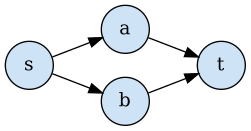 &nbsp;&nbsp; 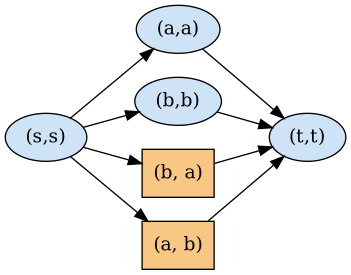

## 2. Three alleles

A bubble with three branches adds one vertex per ordered pair of distinct branches: 3 x 2 = 6.

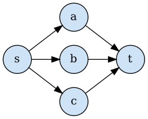 &nbsp;&nbsp; 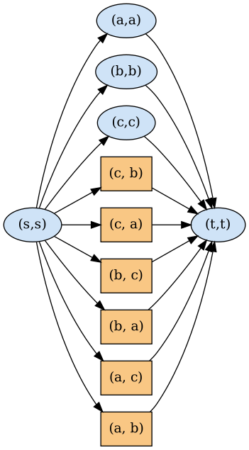

## 3. Two bubbles in series and a large deletion

Two bubbles in series, plus a direct edge `s -> t` that skips both: a large
deletion. The two haplotypes can differ at either bubble, at both, or at none,
and either one can carry the deletion. The deletion makes one more P-node with
two branches (the direct edge and the rest of the graph), so it adds only two
vertices: `(-, rest)` and `(rest, -)`. In all, 13 vertices against 49 for the
Cartesian product.

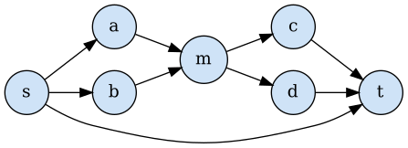<br>
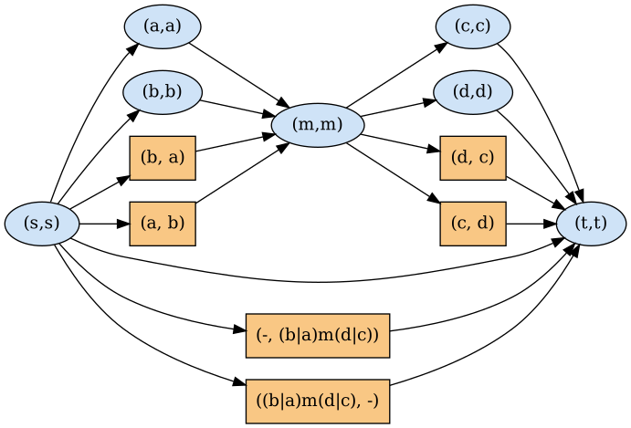

## 4. Nested bubble (insertion carrying a SNP)

One allele of the outer bubble (`s -> t`) is an insertion `a (b|c) d` that itself
carries a SNP. The inner bubble is expanded inside the insertion; the outer bubble
pairs the whole insertion with the direct edge.

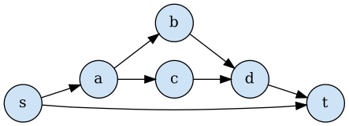 &nbsp;&nbsp; 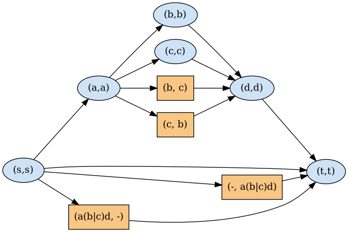

## 5. Random nested series-parallel graph

A larger random example with four nested bubbles.

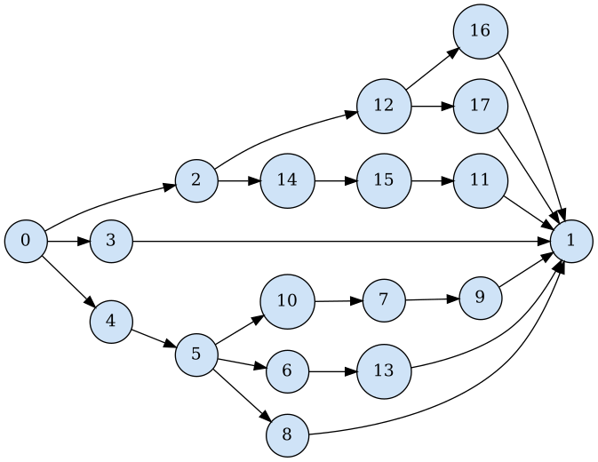<br>
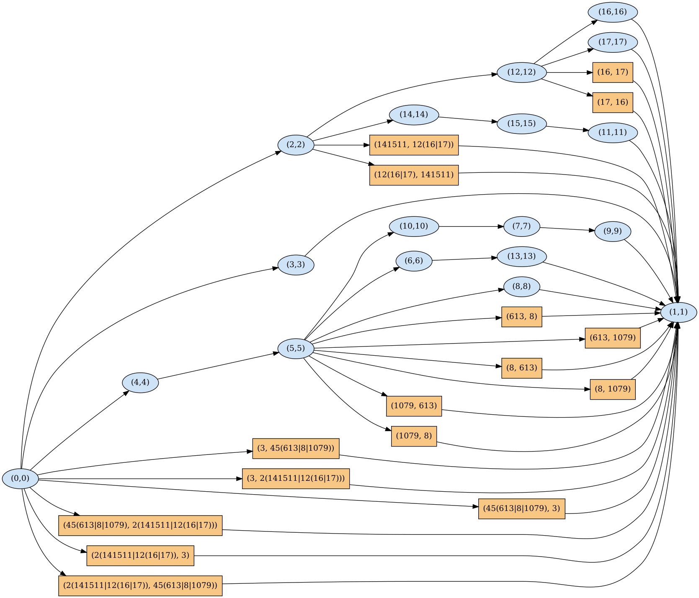

## 6. Bubble followed by a W-motif (non-series-parallel)

A bubble `s -> {a, b} -> m`, then a W-motif with diagonal edge `c -> d`. The bubble
is handled as in example 1; inside the W-motif the two haplotypes are followed with
pair states until they meet again at `d` or `t`. The 6 single-haplotype moves are drawn as
labelled arrows; in the table they are counted as vertices (23 vertices in total).

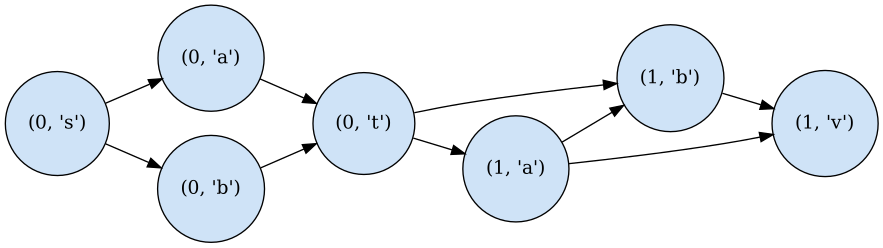<br>
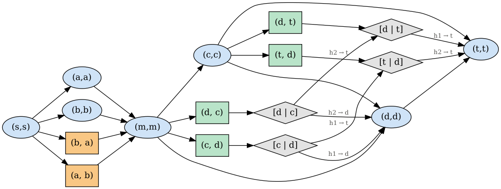

## 7. Worked example of the paper (Figure 1)

The input graph of Figure 1 of the paper: edges `u -> u'`, `u -> v'`, `u' -> c`,
`u' -> d`, `c -> v'`, `d -> v'`, `u' -> v`, `v' -> v`. It is not series-parallel.
The diploid graph has 22 vertices and 32 edges: the homozygous copy (6), the
heterozygous vertices of the P-node between `u'` and `v'` (2), and the
divergence vertices and pair states of the core (14, counting the 6
single-haplotype moves as vertices, as in the table). Brute force confirms that
each of the N^2 = 16 ordered pairs of source-to-sink paths (identical pairs included)
is decoded by exactly one walk.

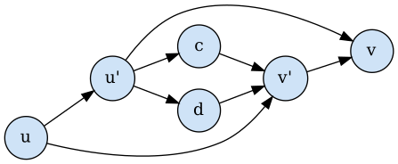<br>
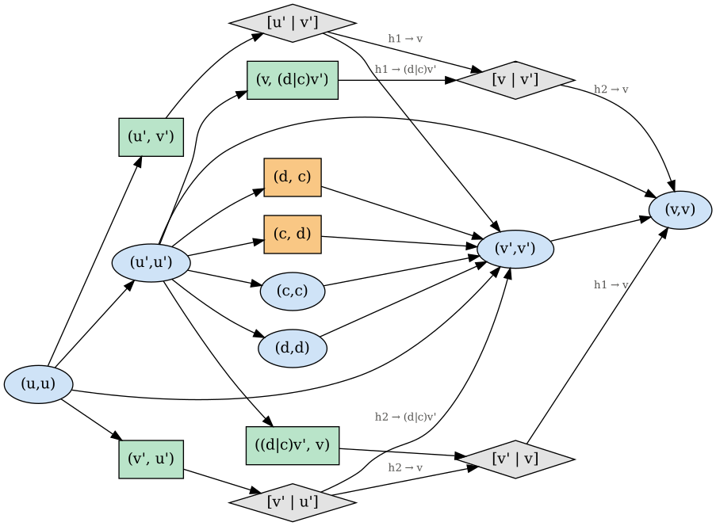

## 8. A locus read from a GFA file: all of the above together

A small locus in GFA format, [data/locus.gfa](data/locus.gfa), the input format
of pangenome graphs: 17 segments (`S`), 24 links (`L`) and 7 haplotype walks
(`W`). It combines every case of the examples above:

* a SNP: segments `2` / `3`;
* three alleles: segments `5` / `6` / `7`;
* a nested insertion: `9 (10|11) 12`, which carries its own SNP and can be
  skipped by the link `8 -> 13`;
* a W-motif (non-series-parallel): `13 -> {14, 15}`, diagonal `14 -> 15`,
  then `16`;
* a large deletion: the link `1 -> 8` skips the SNP and the three alleles.

The haplotype walks look like this (first two of seven):

```
W	GRCh38	0	chr1	0	65	>1>2>4>5>8>9>10>12>13>14>16>17
W	HG001	1	chr1	0	52	>1>3>4>6>8>13>15>16>17
```

Build the diploid graph, check it and report its size from the command line:

```bash
diploidgraph examples/data/locus.gfa --json stats.json
```

Main fields of the output (times and memory depend on the machine):

```
"n_vertices": 17,
"n_edges": 24,
"is_series_parallel": false,
"n_pnodes": 5,
"core_vertices": 6,
"diploid_vertices": 45,
"diploid_edges": 72,
"exactness_check": "exact",
```

The same in Python:

```python
from diploidgraph import build_diploid
from diploidgraph.gfa import read_gfa

g = read_gfa("examples/data/locus.gfa").graph
gd, decomposition = build_diploid(g)
print(gd.num_vertices())   # 45
```

The input has 63 source-to-sink paths, so 63^2 = 3,969 ordered haplotype pairs;
brute force confirms that each is decoded by exactly one walk of the 45-vertex
diploid graph (121 vertices for the Cartesian product). The five bubbles
(P-nodes), including the large deletion, add one vertex per ordered pair of
distinct branches: 2 + 6 + 2 + 2 + 2 = 14 orange boxes, of which the large
deletion gives `(-, ...)` and `(..., -)`. The W-motif is handled by pair states,
as in example 6.

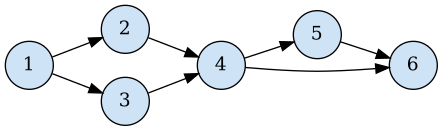<br>
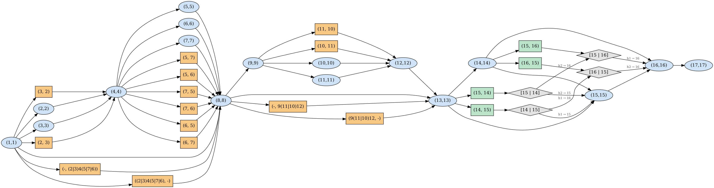
