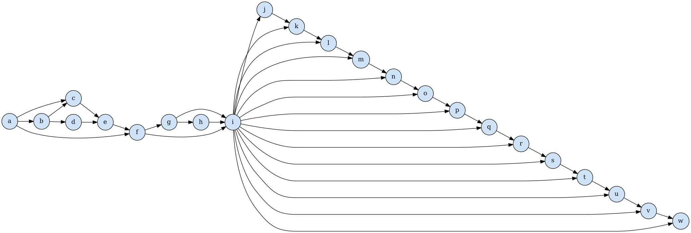
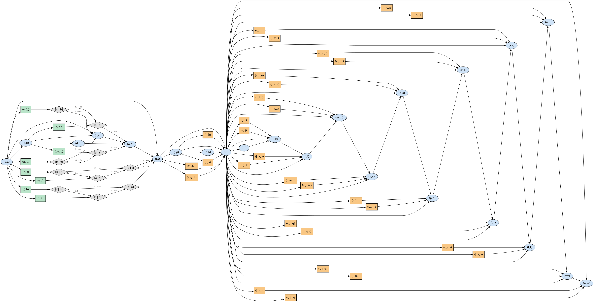
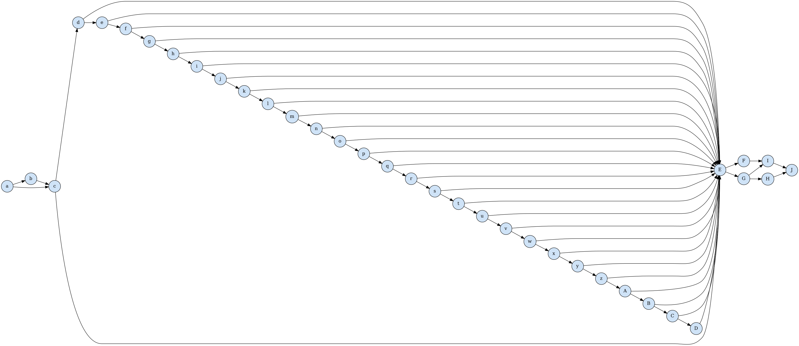
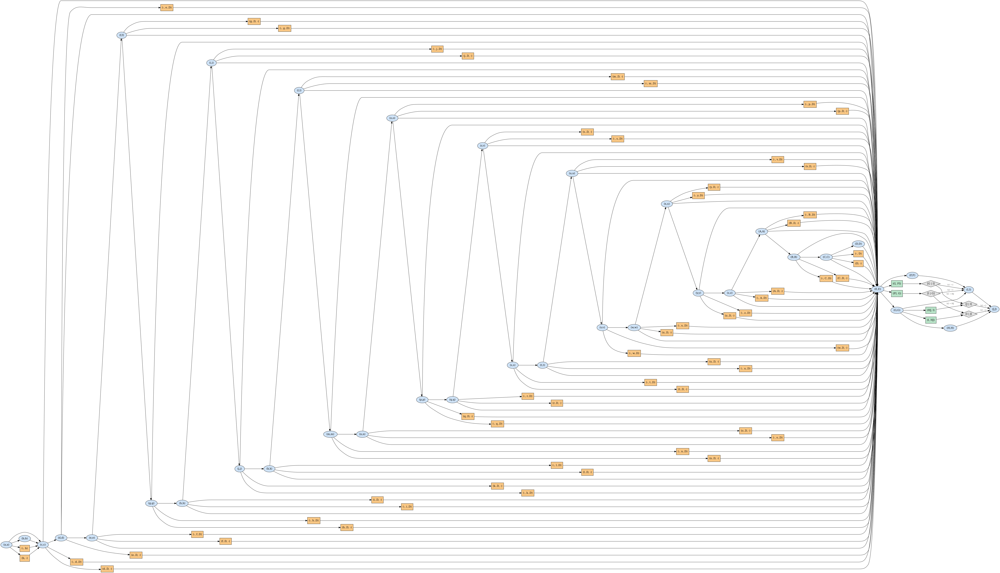

# Worked examples

Two kinds of examples, each with the input graph, its diploid graph and an
exactness check (every ordered pair of source-to-sink paths of the input is
decoded by exactly one walk of the diploid graph, verified by brute force):

* **Small synthetic examples (1 to 8):** made-up graphs, from a single SNP to a
  non-series-parallel W-motif, including the worked example of the paper and a
  synthetic locus in GFA format that combines all of them.
* **Real pangenome data:** windows of the HPRC v2.0 pangenome graphs of BRCA1
  and MHC, the two loci of the paper, with their real sequences and haplotypes.

`python examples/run_examples.py --png` (run from the repository root) regenerates
the figures and the tables below in `examples/out/`.

**Cartesian product** is the Cartesian product with a fixed order of moves: the
same pair-state construction applied to the whole input, without decomposition.
It represents exactly the same haplotype pairs and is counted in the same unit
(vertices), so it shows the saving due to the decomposition.

**How to read the figures.** Blue ellipses `(v,v)` are the homozygous copy of the
input: both haplotypes at `v`. Orange boxes `(x, y)` are heterozygous vertices of a
P-node: haplotype 1 crosses the bubble through branch `x`, haplotype 2 through
branch `y` (`-` is a direct edge; nested alternatives are written `(b|c)`). In
the non-series-parallel examples (6, 7, 8, BRCA1 and MHC), a green box `(c, d)`
is where the two haplotypes separate (haplotype 1 goes to `c`, haplotype 2 to `d`), a grey diamond `[u | v]` is
a pair state (haplotype 1 at `u`, haplotype 2 at `v`), and an arrow labelled
`h1 → t` moves haplotype 1 to `t` while haplotype 2 waits, until both meet again.
All figures are shown at the same scale, except the largest ones, which are
shrunk to the page width; click a figure to open it at full size.

## Small synthetic examples

| Example | \|V\| | s-t paths N | P-nodes | **\|V(G_D)\| (ours)** | \|V\| of Cartesian product | exact |
|---|---|---|---|---|---|---|
| 1. One bubble (SNP) | 4 | 2 | 1 | **6** | 14 | yes |
| 2. Three alleles | 5 | 3 | 1 | **11** | 31 | yes |
| 3. Two bubbles in series and a large deletion | 7 | 5 | 3 | **13** | 49 | yes |
| 4. Nested bubble (insertion carrying a SNP) | 6 | 3 | 2 | **10** | 36 | yes |
| 5. Random nested series-parallel graph | 18 | 7 | 4 | **34** | 262 | yes |
| 6. Bubble followed by a W-motif (non-series-parallel) | 7 | 6 | 1 | **23** | 31 | yes |
| 7. Worked example of the paper (Figure 1) | 6 | 4 | 1 | **22** | 46 | yes |
| 8. A synthetic locus in GFA format (all of the above together) | 17 | 63 | 5 | **45** | 121 | yes |

### 1. One bubble (SNP)

Two alleles `a` and `b`. The diploid graph adds the two heterozygous vertices `(a, b)` and `(b, a)`.

**Input graph (haploid)**

<a href="out/01_bubble_input.png"></a>

**Diploid graph**

<a href="out/01_bubble_diploid.png"></a>

### 2. Three alleles

A bubble with three branches adds one vertex per ordered pair of distinct branches: 3 x 2 = 6.

**Input graph (haploid)**

<a href="out/02_three_alleles_input.png"></a>

**Diploid graph**

<a href="out/02_three_alleles_diploid.png"></a>

### 3. Two bubbles in series and a large deletion

Two bubbles in series, plus a direct edge `s -> t` that skips both: a large
deletion. The two haplotypes can differ at either bubble, at both, or at none,
and either one can carry the deletion. The deletion makes one more P-node with
two branches (the direct edge and the rest of the graph), so it adds only two
vertices, drawn as `(-, (b|a)m(d|c))` and `((b|a)m(d|c), -)`: one haplotype
takes the deletion, the other the rest of the graph. In all, 13 vertices against 49 for the
Cartesian product.

**Input graph (haploid)**

<a href="out/03_two_bubbles_input.png"></a>

**Diploid graph**

<a href="out/03_two_bubbles_diploid.png"></a>

### 4. Nested bubble (insertion carrying a SNP)

One allele of the outer bubble (`s -> t`) is an insertion `a (b|c) d` that itself
carries a SNP. The inner bubble is expanded inside the insertion; the outer bubble
pairs the whole insertion with the direct edge.

**Input graph (haploid)**

<a href="out/04_nested_input.png"></a>

**Diploid graph**

<a href="out/04_nested_diploid.png"></a>

### 5. Random nested series-parallel graph

A larger random example with four nested bubbles.

**Input graph (haploid)**

<a href="out/05_random_sp_input.png"></a>

**Diploid graph**

<a href="out/05_random_sp_diploid.png"></a>

### 6. Bubble followed by a W-motif (non-series-parallel)

A bubble `s -> {a, b} -> m`, then a W-motif with diagonal edge `c -> d`. The bubble
is handled as in example 1; inside the W-motif the two haplotypes are followed with
pair states until they meet again at `d` or `t`. The 6 single-haplotype moves
are drawn as labelled arrows; in the table they are counted as vertices (23 vertices in total).

**Input graph (haploid)**

<a href="out/06_w_motif_input.png"></a>

**Diploid graph**

<a href="out/06_w_motif_diploid.png"></a>

### 7. Worked example of the paper (Figure 1)

The input graph of Figure 1 of the paper: edges `u -> u'`, `u -> v'`, `u' -> c`,
`u' -> d`, `c -> v'`, `d -> v'`, `u' -> v`, `v' -> v`. It is not series-parallel.
The diploid graph has 22 vertices and 32 edges: the homozygous copy (6), the
heterozygous vertices of the P-node between `u'` and `v'` (2), and the
divergence vertices and pair states of the core (14, counting the 6
single-haplotype moves as vertices, as in the table). Brute force confirms that
each of the N^2 = 16 ordered pairs of source-to-sink paths (identical pairs
included) is decoded by exactly one walk.

**Input graph (haploid)**

<a href="out/07_paper_figure1_input.png"></a>

**Diploid graph**

<a href="out/07_paper_figure1_diploid.png"></a>

### 8. A synthetic locus in GFA format: all of the above together

A small synthetic locus (made-up sequences and sample names) in GFA format,
[data/locus.gfa](data/locus.gfa), the input format of pangenome graphs:
17 segments (`S`), 24 links (`L`) and 7 haplotype walks (`W`). It combines every case of the examples above:

* a SNP: segments `2` / `3`;
* three alleles: segments `5` / `6` / `7`;
* a nested insertion: `9 (10|11) 12`, which carries its own SNP and can be
  skipped by the link `8 -> 13`;
* a W-motif (non-series-parallel): `13 -> {14, 15}`, diagonal `14 -> 15`,
  then `16`;
* a large deletion: the link `1 -> 8` skips the SNP and the three alleles.

The haplotype walks look like this (first two of seven):

```
W	sample1	1	locus	0	65	>1>2>4>5>8>9>10>12>13>14>16>17
W	sample2	1	locus	0	52	>1>3>4>6>8>13>15>16>17
```

Build the diploid graph, check it and report its size from the command line:

```bash
diploidgraph examples/data/locus.gfa --json stats.json
```

Main fields of the output (times and memory depend on the machine):

```
"n_vertices": 17,
"n_edges": 24,
"is_series_parallel": false,
"n_pnodes": 5,
"core_vertices": 6,
"diploid_vertices": 45,
"diploid_edges": 72,
"exactness_check": "exact",
```

The same in Python:

```python
from diploidgraph import build_diploid
from diploidgraph.gfa import read_gfa

g = read_gfa("examples/data/locus.gfa").graph
gd, decomposition = build_diploid(g)
print(gd.num_vertices())   # 45
```

The input has 63 source-to-sink paths, so 63^2 = 3,969 ordered haplotype pairs;
brute force confirms that each is decoded by exactly one walk of the 45-vertex
diploid graph (121 vertices for the Cartesian product). The five bubbles
(P-nodes), including the large deletion, add one vertex per ordered pair of
distinct branches: 2 + 6 + 2 + 2 + 2 = 14 orange boxes, of which the large
deletion gives `(-, ...)` and `(..., -)`. The W-motif is handled by pair states,
as in example 6.

**Input graph (haploid)**

<a href="out/08_gfa_input.png"></a>

**Diploid graph**

<a href="out/08_gfa_diploid.png"></a>

## Real pangenome data (HPRC v2.0)

| Example | \|V\| | s-t paths N | P-nodes | **\|V(G_D)\| (ours)** | \|V\| of Cartesian product | exact |
|---|---|---|---|---|---|---|
| BRCA1 window: a CA repeat | 23 | 168 | 15 | **85** | 623 | yes |
| MHC window: a 164 bp insertion and a poly-A tract | 36 | 168 | 28 | **106** | 278 | yes |

### BRCA1: a CA repeat

A real piece of the BRCA1 graph used in the paper (HPRC v2.0 Minigraph-Cactus,
GRCh38-based), [data/brca1_window.gfa](data/brca1_window.gfa): 23 segments,
40 links and 464 haplotype walks (assemblies of HPRC samples, plus GRCh38 and
CHM13), with their real segment IDs, sequences and coordinates. The full graph
has 465 walks; one of them does not pass through this window. The window was cut
from the full graph with

```bash
python examples/extract_window.py BRCA1.gfa --pick 1 --out examples/data/brca1_window.gfa
```

which looks for a window between two vertices that every haplotype passes
through, and prefers windows with a non-series-parallel core, a large deletion
and many bubbles.

The figures write the segments as letters in their order: `a` = 62857415,
`b` = 62857416, ..., `w` = 62857437.

* **A CA repeat.** After segment `i`, a haplotype goes through between 0 and 13
  repeat segments (`j` to `v`: `CA`, `CACACACA`, ...) before the last segment
  `w`, so the haplotypes differ in the number of repeat units. Skipping all of
  them is a 32 bp deletion. In the diploid graph, a branch through some of the
  repeat segments `j` to `t` is written `j..t`; `(-, j..t)` means haplotype 1
  skips these repeat segments and haplotype 2 goes through some of them.
* **A W-motif.** The start of the window is not series-parallel:
  `a -> {b, c}` with the diagonal `b -> c`, and the edge `a -> f` skips it.
  This part is handled by pair states (green boxes and grey diamonds).

```bash
diploidgraph examples/data/brca1_window.gfa --json stats.json
```

```
"n_vertices": 23,
"n_edges": 40,
"n_haplotype_walks": 464,
"n_distinct_full_haplotype_walks": 24,
"is_series_parallel": false,
"n_pnodes": 15,
"core_vertices": 6,
"diploid_vertices": 85,
"diploid_edges": 144,
"exactness_check": "exact",
```

The 464 walks contain only 24 distinct haplotypes, but the graph has 168
source-to-sink paths. The diploid graph represents all 168^2 = 28,224 ordered
pairs, including pairs no sample carries, each by exactly one walk (checked by
brute force), with 85 vertices; the Cartesian product needs 623.

**Input graph (haploid)**

<a href="out/09_brca1_window_input.png"></a>

**Diploid graph**

<a href="out/09_brca1_window_diploid.png"></a>

### MHC: a 164 bp insertion and a poly-A tract

A real piece of the MHC graph used in the paper (HPRC v2.0 Minigraph-Cactus,
GRCh38-based), [data/mhc_window.gfa](data/mhc_window.gfa): 36 segments,
65 links and 464 haplotype walks with their real segment IDs, sequences and
coordinates. The full graph has 466 walks; two of them do not pass through this
window. It was cut from the full graph (349,475 vertices) with

```bash
python examples/extract_window.py MHC.gfa --pick 1 --out examples/data/mhc_window.gfa
```

The figures write the segments as letters in the order of the file: `a` to `D`
are 160796817 to 160796846, then `E` = 160796847, `F` = 160796850,
`G` = 160796848, `H` = 160796849, `I` = 160796851, `J` = 160796852.

* **A 164 bp insertion.** Segment `b` (164 bp) can be skipped by the edge
  `a -> c`; 5 of the 464 haplotypes carry it.
* **A poly-A tract.** Segments `c` to `D` are all `A`, and every one of them has
  an edge to `E`, so a haplotype goes through between 0 and 27 of the segments
  `d` to `D` (30 bp of `A` in all), and the haplotypes differ in
  the length of the tract. In the diploid graph, `(-, e..D)` means haplotype 1
  leaves the tract at that point and haplotype 2 goes on through some of the
  segments `e` to `D`.
* **A W-motif.** The end of the window is not series-parallel:
  `E -> {F, G}`, `F -> I`, `G -> I` (the diagonal), `G -> H -> J` and
  `I -> J`. It is handled by pair states (green boxes and grey diamonds).

```bash
diploidgraph examples/data/mhc_window.gfa --json stats.json
```

```
"n_vertices": 36,
"n_edges": 65,
"n_haplotype_walks": 464,
"n_distinct_full_haplotype_walks": 32,
"is_series_parallel": false,
"n_pnodes": 28,
"core_vertices": 5,
"diploid_vertices": 106,
"diploid_edges": 197,
"exactness_check": "exact",
```

The 464 walks contain 32 distinct haplotypes; the graph has 168 source-to-sink
paths. The diploid graph represents all 168^2 = 28,224 ordered pairs, each by
exactly one walk (checked by brute force), with 106 vertices; the Cartesian
product needs 278.

**Input graph (haploid)**

<a href="out/10_mhc_window_input.png"></a>

**Diploid graph**

<a href="out/10_mhc_window_diploid.png"></a>
