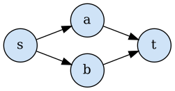
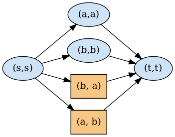
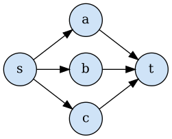
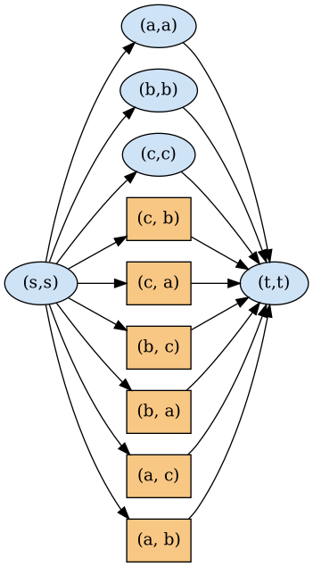
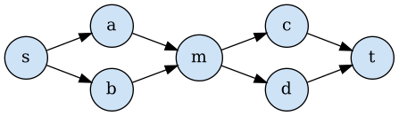
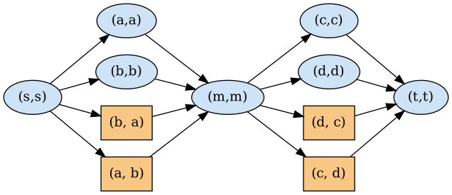
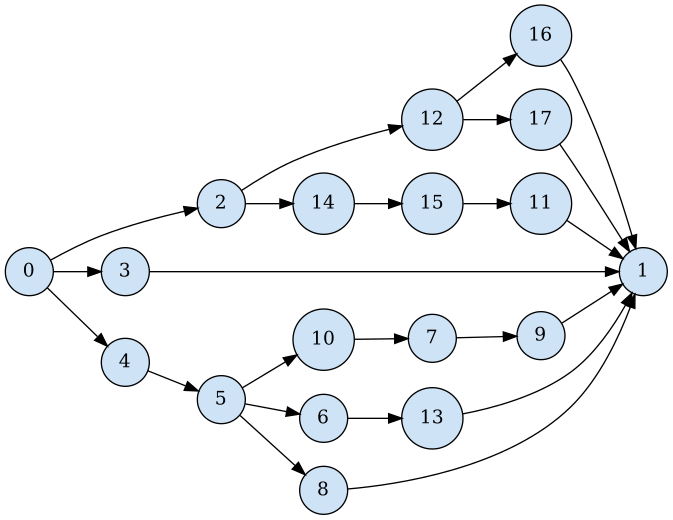
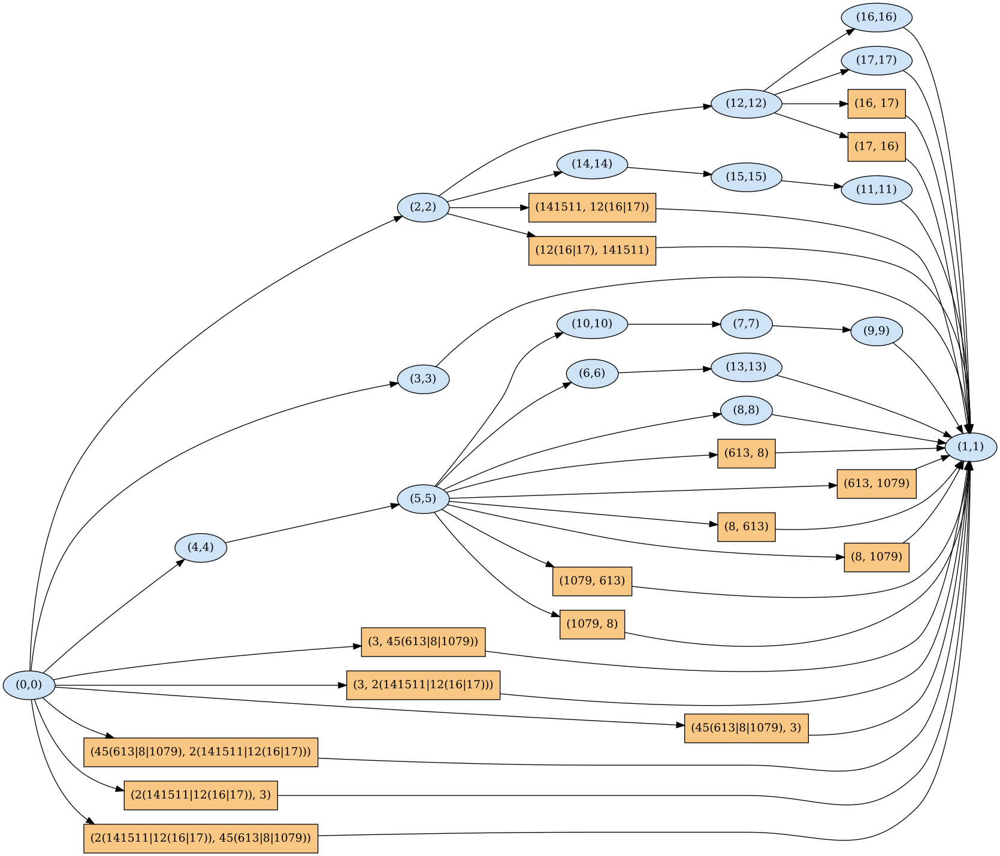

# Worked examples

Six small sequence graphs, from a single SNP to a non-series-parallel W-motif.
For each one: the input graph, its diploid graph, and an exactness check (every
ordered pair of source-to-sink paths of the input is decoded by exactly one walk
of the diploid graph, verified by brute force).

`python examples/run_examples.py --png` (run from the repository root) regenerates
the figures and the table below in `examples/out/`.

| Example | |V| | s-t paths N | P-nodes | |V(G_D)| | new vertices | naive N(N-1) | exact |
|---|---|---|---|---|---|---|---|
| 1. One bubble (SNP) | 4 | 2 | 1 | 6 | 2 | 2 | yes |
| 2. Three alleles | 5 | 3 | 1 | 11 | 6 | 6 | yes |
| 3. Two bubbles in series | 7 | 4 | 2 | 11 | 4 | 12 | yes |
| 4. Nested bubble (insertion carrying a SNP) | 6 | 3 | 2 | 10 | 4 | 6 | yes |
| 5. Random nested series-parallel graph | 18 | 7 | 4 | 34 | 16 | 42 | yes |
| 6. Bubble followed by a W-motif (non-series-parallel) | 7 | 6 | 1 | 23 | 16 | 30 | yes |

**How to read the figures.** Blue ellipses `(v,v)` are the homozygous copy of the
input: both haplotypes at `v`. Orange boxes `(x, y)` are heterozygous vertices of a
P-node: haplotype 1 crosses the bubble through branch `x`, haplotype 2 through
branch `y` (`-` is a direct edge; nested alternatives are written `(b|c)`). In the
non-series-parallel example, green boxes move one or both haplotypes along a core
edge to the named vertex (`·` = this haplotype waits), and grey diamonds
`[u | v]` are pair states: haplotype 1 at `u`, haplotype 2 at `v`.

## 1. One bubble (SNP)

Two alleles `a` and `b`. The diploid graph adds the two heterozygous vertices `(a, b)` and `(b, a)`.

 &nbsp;&nbsp; 

## 2. Three alleles

A bubble with three branches adds one vertex per ordered pair of distinct branches: 3 x 2 = 6.

 &nbsp;&nbsp; 

## 3. Two bubbles in series

The two haplotypes can differ at either bubble, at both, or at none. Each bubble is
expanded once (4 new vertices), while naive pairing needs 12 pairs.

 

## 4. Nested bubble (insertion carrying a SNP)

One allele of the outer bubble (`s -> t`) is an insertion `a (b|c) d` that itself
carries a SNP. The inner bubble is expanded inside the insertion; the outer bubble
pairs the whole insertion with the direct edge.

 &nbsp;&nbsp; 

## 5. Random nested series-parallel graph

A larger random example with four nested bubbles.

 

## 6. Bubble followed by a W-motif (non-series-parallel)

A bubble `s -> {a, b} -> m`, then a W-motif with diagonal edge `c -> d`. The bubble
is handled as in example 1; inside the W-motif the two haplotypes are followed with
pair states until they meet again at `d` or `t`.

 

