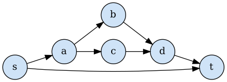
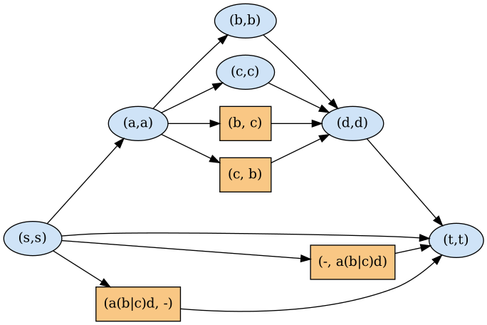
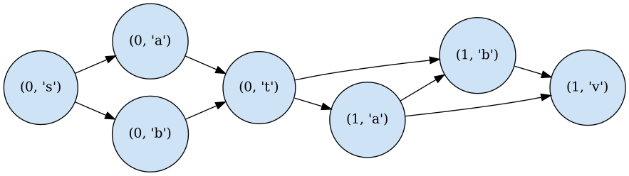
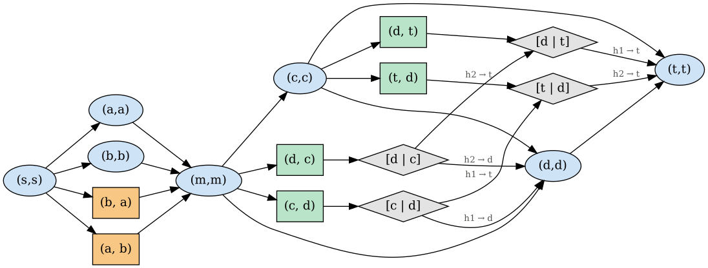

# Worked examples

`python examples/run_examples.py --png` (run from the repository root) writes the input graph, the diploid
graph and a summary table for each example to `examples/out/`.

| Example | |V| | s-t paths N | P-nodes | |V(G_D)| | new vertices | naive N(N-1) | exact |
|---|---|---|---|---|---|---|---|
| One bubble (SNP) | 4 | 2 | 1 | 6 | 2 | 2 | yes |
| Three alleles | 5 | 3 | 1 | 11 | 6 | 6 | yes |
| Two bubbles in series | 7 | 4 | 2 | 11 | 4 | 12 | yes |
| Nested bubble (insertion carrying a SNP) | 6 | 3 | 2 | 10 | 4 | 6 | yes |
| Random nested SP graph | 18 | 7 | 4 | 34 | 16 | 42 | yes |
| Bubble followed by a W-motif (non-SP) | 7 | 6 | 1 | 23 | 16 | 30 | yes |

Nested bubble: input (left) and diploid graph (right). Blue vertices are
homozygous; orange vertices are heterozygous pairs of branches, written with
nested alternatives as `(x|y)`.

Bubble followed by a W-motif (diagonal `c -> d`): input (top) and diploid graph
(bottom). Green boxes move one or both haplotypes along a core edge (`·` = does
not move); grey diamonds are pair states `[hap 1 | hap 2]`.

 

Figures are drawn with Graphviz from the `.dot` files in `out/`. Each example is
checked by brute force: every ordered pair of source-to-sink paths of the input
is decoded by exactly one walk of the diploid graph.
